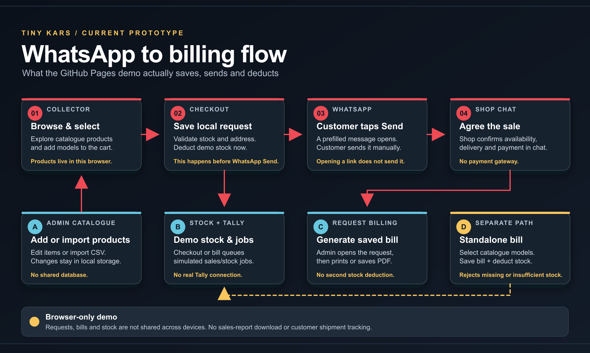
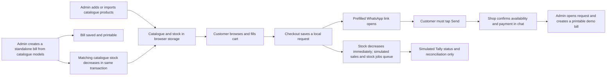

# Tiny Kars current prototype flow

The site is a **client-side demo** on GitHub Pages. Requests, bills, inventory and settings live in each browser's local storage. They are not shared between the customer and shop devices. Opening WhatsApp does not send a message or prove that payment was received. There is no payment gateway or customer shipment tracking.

Products can be added or edited in Admin → Products or imported from a validated catalogue CSV. New product data and inventory changes stay in that browser. The CSV export is for products, not a sales report.

Checkout validates available stock, creates a local request, deducts stock immediately and queues simulated sales/stock Tally jobs. The customer then reviews and sends the WhatsApp message manually. Cancelling a new request restores local stock once. Generating a bill **from an existing request** uses the already saved prices and does not deduct stock a second time.

Admin → Bills & settings can also create a standalone bill from catalogue models. The bill and stock deduction happen in the same local transaction; a missing SKU or insufficient aggregate stock rejects the whole bill. A bill generated from an existing request does not deduct stock again. The Tally screen is a simulation; it does not connect to TallyPrime. There is currently no downloadable sales report. A shared backend is still needed before real business use.
