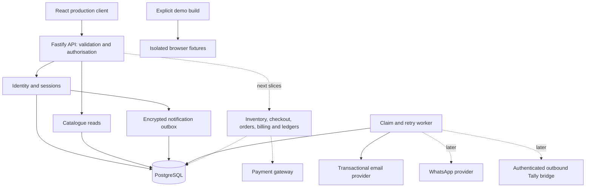

# Tiny Kars implementation brief

Prepared: 27 October 2026. Updated: 28 October 2026. Status: account/catalogue foundation and local admin catalogue operations implemented; commerce and live provider checks remain open.

Business scope comes from [the chat-derived brief](chat-derived-production-brief.md). The older architecture and deployment documents describe proposals, not additional client-approved business rules. The user has now selected **email/password sign-in with email verification and password reset**. Phone OTP is outside this slice.

## Repository findings

The starting application is React 19, TypeScript, Vite, and React Router. It has reusable branding, product cards, filter patterns, billing layouts, and mobile styling. Its `src/services/storage.ts` persists a single browser-local document. `src/services/account.ts` accepts a displayed fixed demo OTP and can switch users without authenticating. `src/services/orders.ts` creates local orders and changes local stock; payment is handed to WhatsApp. Tally processing is simulated. The README explicitly documents these limits.

The existing catalogue filters cover search, brand, series, scale, maximum price, condition, stock, rarity, offers, and sorting. The initial product type lacks manufacture year and a real multi-image collection. Existing artwork is illustrative and cannot be promoted into authentic photographs of the supplied catalogue.

The current test suite verifies prototype behaviour. Passing it does not verify server authorisation, PostgreSQL transactions, payment processing, email delivery, or production recovery. Existing documentation and other user edits must be preserved. The legacy app remains an explicit demo build; production must not import its seeded customers, local payment state, or admin switcher.

## Selected first slice

Implement a real PostgreSQL-backed catalogue and customer-account flow on a Fastify API, with an isolated production React entry point and an encrypted, durable email outbox. The slice is designed to run and be tested locally without payment, Tally, R2, or courier credentials.

The concrete customer path is: open catalogue → filter/search → inspect product → register → verify email → sign in → view own account → sign out, plus request password reset → reset once → old sessions no longer work. Verification email and reset email delivery need an actual configured provider before the live customer path can be declared complete.

Public catalogue access is a reversible proposed default pending confirmation of the ambiguous browsing note. Registration always creates a customer; submitted roles cannot grant privileges. Admin/staff authentication requires MFA. Checkout and payment are connected in the production entry point; loyalty, wallet/refund and billing management screens are implemented, while business values still require approval.

Publish only explicitly published catalogue rows. Development fixtures are opt-in and must not seed or publish themselves into a production database. Product year remains unknown when source data does not provide it. Five image positions are supported without inventing missing photographs or client-approved angle names.

## Requirement traceability and gaps

Numbers refer to all 52 entries in the chat-derived requirements. “First slice” below identifies the implementation target, not a claim that verification has passed.

| Requirement IDs    | Starting state / gap                                        | UI, API, and data responsibility                                                          | Permission / background work                                  | Acceptance evidence and delivery                                                                                                               |
| ------------------ | ----------------------------------------------------------- | ----------------------------------------------------------------------------------------- | ------------------------------------------------------------- | ---------------------------------------------------------------------------------------------------------------------------------------------- |
| 1, 8               | Browser-seeded products and client filters                  | Production catalogue/detail; `GET /api/products`, `GET /api/products/:id`; products/media | Public published-only reads; bounded queries                  | Real PostgreSQL filter, pagination, draft exclusion, invalid-input tests; first slice                                                          |
| 2, 3, 4            | Fixed OTP and user switching                                | Register/login/verify/reset/account; `/api/auth/*`; users, sessions, action tokens        | Customer-only registration; hashed secrets; email outbox      | Verification/token expiry/reuse, wrong credentials, logout, reset revocation, CSRF tests; first slice; live email evidence pending credentials |
| 5                  | Fixed demo shipping                                         | Checkout; shipping quote/rules and order snapshot                                         | Server prices shipping; override policy unresolved            | Approved pricing examples and client-tamper tests; later commerce slice                                                                        |
| 6, 7               | Browser order history/timeline                              | Account orders and order detail; orders/items/status history                              | Ownership-filtered reads                                      | Customer A cannot read B's orders; persisted history/status tests; later commerce slice                                                        |
| 9                  | No gateway                                                  | Hosted checkout; payments/webhook inbox                                                   | Verified provider event, idempotency, reservation conversion  | Provider sandbox and webhook replay/concurrency evidence; later commerce slice                                                                 |
| 10, 11             | Manual WhatsApp deep link, no automatic email               | Confirmation states and delivery failures; notification outbox                            | Workers, approved Meta templates and provider references      | Email worker foundation first; order/WhatsApp sandbox evidence later                                                                           |
| 12, 13             | Unrestricted demo status advance                            | Fulfilment screen; shipment/delivery event records                                        | Authorised staff or configured courier                        | Permission, timestamp, evidence, replay tests; operations slice                                                                                |
| 14, 15, 16, 17, 18 | Name/brand/price/series present locally; year absent        | Product DTO and catalogue schema with price in paise and nullable year                    | Published-only projection                                     | Attribute/price validation and detail tests; first slice                                                                                       |
| 19                 | Final catalogue not supplied                                | Import contract and catalogue content                                                     | Gopal Sagar supplies authoritative data                       | Content approval remains a client dependency                                                                                                   |
| 20, 21             | Placeholder crops, no approved five views                   | Five-position product media/gallery; future upload/finalise endpoint                      | Admin uploads later; slot meanings configurable               | Gallery behaviour first; actual images and publication rule require client data                                                                |
| 22                 | Immediate browser CSV import                                | Staging/preview/commit import workflow; import jobs/rows                                  | Admin; durable commit and validation                          | Row errors, rollback, retry/idempotency and export-safety tests; catalogue operations slice                                                    |
| 23, 24, 25, 26     | SKU exists; no generated unit labels                        | Code generation and print labels; product identifiers/optional units                      | Admin; uniqueness/assignment constraints                      | Collision/concurrent assignment and scannable print tests; serial policy decision required                                                     |
| 27, 28             | No points ledger                                            | Customer points and admin rules; policy versions/ledger                                   | Admin configuration; deferred maturation/reversal if approved | Policy examples, concurrent redemption/reversal tests; loyalty slice                                                                           |
| 29, 30, 31         | Reusable demo percentage codes                              | Voucher management/application; vouchers/reservations/redemptions                         | Admin and server atomic limit checks                          | Two concurrent uses of the last available code cannot both succeed; commerce slice                                                             |
| 32, 33, 34, 35     | Local refund flag; no wallet; credentials note ambiguous    | Refund flow and credit history; refunds/wallet entries                                    | Admin; gateway jobs; safe transaction IDs only                | Partial/refund replay, balance locks, no credential storage, inspected restock separation; operations slice                                    |
| 36, 39, 40, 41, 42 | Local manual bills; no shared stock decrement               | Responsive invoice desk; invoices/lines/sequences/channel/allocations                     | Authorised seller/admin; immutable issue transaction          | Unique number, channel report, serial allocation, reprint snapshot tests; billing slice                                                        |
| 37                 | Simulated Tally queue                                       | Integration exception view; accounting outbox/mappings                                    | Outbound local bridge and retry/reconciliation                | Real test-company sale/refund/invoice evidence; accountant mappings required                                                                   |
| 38                 | Public demo admin switch                                    | Privileged authentication/session boundary                                                | MFA required; fail closed while absent                        | No customer can become admin; login denied before MFA path exists; full admin login later                                                      |
| 43, 44, 45, 46, 47 | No seller role                                              | Seller login and billing workspace; permission assignments                                | Minimum necessary reads and allowed bill generation           | Role-denial matrix and billing transaction tests; server role foundation first, seller workflow later                                          |
| 48, 49, 50, 51, 52 | Existing visual identity, jargon and simulated interactions | Responsive production shell, catalogue, account forms, feedback states                    | No privileged data in browser cache; accessible controls      | Mobile/desktop, keyboard, contrast, reduced-motion and error-recovery checks; first slice plus later purchase journey usability study          |

## Information architecture

| Audience    | First slice                                                                                                                                                   | Following slices                                                                                                                                                        |
| ----------- | ------------------------------------------------------------------------------------------------------------------------------------------------------------- | ----------------------------------------------------------------------------------------------------------------------------------------------------------------------- |
| Customer    | Home/shop, searchable filterable catalogue, product detail, create account, verify email, sign in, reset password, own account, help/availability explanation | Cart, delivery address, shipping quote, payment, confirmation, past orders, invoice, delivery, loyalty and credit history                                               |
| Seller      | Protected boundary; no demo role switching                                                                                                                    | Sign in with approved verification, billing desk, permitted bill history/reprint                                                                                        |
| Admin/staff | Protected boundary; MFA-dependent operations unavailable                                                                                                      | Products/images, CSV preview, inventory/labels, orders/delivery, bills, customers needed for support, vouchers, loyalty, refunds/credits, Tally/notification exceptions |

On mobile, place search above results and expose filters through clearly labelled controls. Product detail puts images, name, price, availability, and next action together. Account forms use visible labels and actionable error messages. Missing backend functionality receives an accurate unavailable state; it must not create an apparent paid order.

## Module and dependency decisions

ADR-001: Keep a TypeScript modular monolith and PostgreSQL. Module-owned functions and transactions define boundaries; separate network services are unnecessary at the expected initial scope.

ADR-002: Use a separate production React entry and explicit demo mode. Reuse branding and UX patterns while preventing the demo's credentials, inventory, orders, and status controls from being production truth.

ADR-003: Email/password is the user's selected account method. Email verification and reset use expiring single-use tokens; only hashes are stored for token lookup. Durable notification payloads containing action URLs are encrypted at rest and erased after a confirmed provider send or when the link becomes inactive. Failed deliveries retain encrypted payloads for bounded retry, then scheduled maintenance erases them after seven days.

ADR-004: Start with a PostgreSQL outbox and worker. Retry delivery with a stable key, leases, bounded attempts, and failure visibility. External email cannot be guaranteed exactly once after an ambiguous network failure; provider idempotency and reconciliation must narrow that ambiguity without claiming otherwise.

ADR-005: Customer signup cannot assign roles. Admin/staff entry fails closed until MFA and provisioning workflows exist. Seller access requires its own approved permission surface.

ADR-006: Store currency as paise, preserve unknown product facts as null, and preserve media slots without inferring their meaning. Payment secrets, customer banking passwords, card details, and PINs are never catalogue/account data.

## Schema and migration sequence

Apply ordered, checksum-tracked migrations under a database advisory lock; each migration is transactional. Reject edited already-applied files. Use separate development/test databases and explicit fixture loading. Never migrate browser-demo customers or orders into live commerce automatically.

| Sequence             | Tables / boundaries                                                                                                                           | Required constraints                                                                                                                             |
| -------------------- | --------------------------------------------------------------------------------------------------------------------------------------------- | ------------------------------------------------------------------------------------------------------------------------------------------------ |
| First foundation     | Users, sessions, verification/reset tokens, auth attempt buckets, encrypted notification outbox, append-only audit records, migration history | Normalised unique email; allowed roles; hashed tokens; expiry; single use; encrypted payload; foreign keys; reset/session revocation transaction |
| Catalogue            | Products and media slots                                                                                                                      | Unique SKU; integer nonnegative paise; MRP validation; publish date; one media entry per product/slot; bounded slot 1–5                          |
| Catalogue operations | Import jobs/rows, inventory balances/movements, optional units/serials                                                                        | Unique identifiers; source checksums; serial assignment constraints; immutable movement history                                                  |
| Checkout             | Addresses, reservations, order/item snapshots, voucher holds/redemptions, payments/webhook inbox                                              | Nonnegative availability; unique provider event/reference; request idempotency; atomic scarce-resource holds                                     |
| Operations           | Shipments, refunds, wallet/loyalty ledgers, policy versions, invoices and sequences                                                           | Append-only ledgers; locked balances; maximum refundable amount; unique invoice/credit-note number                                               |
| Accounting           | Tally entity mappings, canonical accounting events/jobs/attempts                                                                              | Stable deduplication key; safe replay; immutable commercial payload                                                                              |

Before accepting payment, voucher/credit/stock eligibility must be held together. If a payment completes after its hold expires, reconciliation must enter an explicit exception/refund path rather than oversell or silently reject a captured payment. This is a later checkout design requirement, not part of catalogue authentication.

## Threat model and failure cases

| Risk                                                    | Required control / check                                                                                                             |
| ------------------------------------------------------- | ------------------------------------------------------------------------------------------------------------------------------------ |
| Demo admin or local state reaches production            | Separate entry/build, no demo imports in production business paths, negative navigation tests                                        |
| Role injection or another customer's data disclosure    | Fixed signup role, server role/ownership checks, deny tests with authenticated second user                                           |
| Session theft, fixation, CSRF                           | HttpOnly/Secure production cookie, SameSite, origin check, per-session CSRF token, session rotation/logout                           |
| Reset/verify link leakage or replay                     | Hash lookup tokens, encrypt outbox payload, redact URLs/passwords from logs, single-use expiry, explicit user action to consume link |
| Reset races preserve an old authenticated session       | Lock relevant user/token rows and atomically revoke sessions; concurrent login/reset tests                                           |
| Enumeration and login/notification abuse                | Generic request responses, similar work paths, bounded input, per-IP/account throttles and delivery limits                           |
| Database injection or expensive catalogue queries       | Runtime schemas, parameterised SQL, allow-listed sort columns, pagination bounds, indexes, request timeouts                          |
| Email is sent twice or silently lost after worker crash | Durable claims/leases, provider idempotency, bounded retry, retained safe error state, crash/retry tests                             |
| Deployment exposes secrets or silently skips migrations | Required validated config, production startup checks, redaction, checksum migrations, readiness failure                              |
| Outage or restore loses account/order data              | Backups, off-provider exports, measured restore drill; alerting; later payment reconciliation after recovery                         |

Privileged MFA, upload inspection, payment verification, concurrent stock/wallet/voucher guarantees, and Tally replay are launch blockers for the corresponding future modules. They are not satisfied by the first-slice account tests.

## Phased backlog and acceptance gates

| Phase                     | Deliverable and dependency                                                                                    | Exit evidence                                                                                                                                                                                |
| ------------------------- | ------------------------------------------------------------------------------------------------------------- | -------------------------------------------------------------------------------------------------------------------------------------------------------------------------------------------- |
| 0 — brief                 | This repository audit, all requirement IDs, decisions, schema plan                                            | Scope reviewed against chat; no additional business policies asserted                                                                                                                        |
| 1 — first slice           | Database/API foundation, catalogue reads, isolated UI, confirmed email account method, encrypted email outbox | PostgreSQL migration/filter/account/security tests; API contract; production/demo builds; mobile/desktop account/catalogue browser checks; actual provider send remains separately evidenced |
| 2 — catalogue operations  | Admin MFA/provisioning, product edits/media uploads, staged CSV, stock/serial model, labels                   | Role denial, malicious upload/export handling, import rollback/replay, duplicate identifier and printable label checks                                                                       |
| 3 — commerce              | Approved shipping/tax/voucher rules; atomic reservations; gateway orders/capture events; history              | Signed webhook sandbox evidence, duplicate and late-payment paths, last-item/voucher/credit races, own-order isolation                                                                       |
| 4 — operations            | Delivery policy, refunds/store credit, loyalty policy, seller permission scope, offline invoice rules         | Ledger/reversal and partial-refund tests; invoice races; seller-denial matrix; notification failure recovery                                                                                 |
| 5 — accounting and launch | Real Tally installation/mappings, production accounts/domains/provider activation                             | Accountant-approved test-company scenarios; tested restore, backup/alerts, performance/accessibility review, domain/email configuration, rollback handover                                   |

Do not advance a disabled feature to “available” until its backend, permissions, failure states, and acceptance checks exist. A local test against a controlled email transport proves adapter behaviour, not delivery to a real inbox.

## Decisions and external dependencies

Confirmed: email/password, email verification, password reset, Razorpay as the intended gateway, and super admin as the owner of business-rule approval. Existing Tiny Kars branding and React/Vite are retained. Low-cost deployment is based on the supplied Cloudflare/Railway plan. Razorpay keys and the approved shipping, GST/invoice, voucher, loyalty, and refund rules are still pending.

Required for live account release: client-owned email provider credential, verified sending domain, exact public origin, stable runtime encryption key, and a real verification/reset send test. These values must be configured securely, never pasted into source or documentation.

Configurable while catalogue/account work continues: public browsing policy, shipping rules, image-slot names and publish minimum, product versus unit serialisation, voucher one-time interpretation, loyalty rates/expiry/stacking, refund/store-credit policy, seller field-level permissions, and staff delivery policy. Their absence must disable dependent financial actions rather than fill them with arbitrary production defaults.

Required for later modules: Gopal Sagar's catalogue and real product photographs; gateway merchant activation/test/live credentials; Meta sender/templates/consent setup; accountant-approved taxes/invoice rules; TallyPrime version/company/mappings; stock authority; native-app versus responsive-web decision. “Offline sale” means an in-store/manual sales channel in this scope; working without internet would need explicit requirements and conflict-resolution design.

## Deployment estimate and ownership

Official pages were checked on 27 October 2026. A budget is an estimate based on traffic and resource use; checkout prices and terms remain authoritative.

| Component        | Current public price or limit                                                                                                            | Planning implication                                                                                                                                            |
| ---------------- | ---------------------------------------------------------------------------------------------------------------------------------------- | --------------------------------------------------------------------------------------------------------------------------------------------------------------- |
| Railway Pro      | USD 20 monthly minimum usage commitment with USD 20 usage included; higher resource use adds cost                                        | Initial API, worker, PostgreSQL budget floor; not a fixed all-inclusive bill. [Railway pricing](https://railway.com/pricing)                                    |
| Cloudflare Pages | Free-plan limits include 500 builds/month and 100 custom domains/project                                                                 | Static frontend can start on the free plan within limits. [Pages limits](https://developers.cloudflare.com/pages/platform/limits/)                              |
| R2 Standard      | USD 0.015/GB-month after free allowance; 10 GB-month storage, 1M Class A and 10M Class B operations included monthly; direct egress free | Small compressed catalogue may fit included usage; request volume still matters. [R2 pricing](https://developers.cloudflare.com/r2/pricing/)                    |
| Domain           | `.com` table lists USD 11.17 registration and renewal for ordinary names                                                                 | Availability, premium names, tax and checkout still need checking; no domain has been purchased. [Registrar pricing](https://pricing.registrar.cloudflare.com/) |

For estimation only, reserve USD 20–60/month for small-store infrastructure before tax, plus domain and provider charges. This is an engineering planning band, not a vendor quote or availability guarantee. Email, WhatsApp, SMS if later chosen, gateway transactions, monitoring upgrades, database high availability, and Tally licensing are additional where applicable. Recalculate after observing real memory/CPU/storage/traffic.

Keep production accounts and domain ownership with the client. The first slice prepares deployable code and runbooks; it does not provision paid services, purchase a domain, send unsolicited messages, activate live payment, or claim deployed backups. A managed single-node database with restore capability still has an outage window; zero-downtime expectations require a separately sized availability design.

## Verification record

The implemented slice contains a PostgreSQL schema and checksum migration runner, published-only catalogue reads with all currently supported demo filters, five media slots, public product pages, email/password registration and login, email verification, password reset, revocable sessions, server-side role boundaries, CSRF protection, rate limits, an encrypted notification outbox, a Resend worker, health endpoints, and generated OpenAPI at `/api/openapi.json`. The original browser-only demo remains an explicit, separate build.

Verification performed locally:

| Command or check                           | Result                                                                                                                                                                                                                                                             | Limit                                                                                                                              |
| ------------------------------------------ | ------------------------------------------------------------------------------------------------------------------------------------------------------------------------------------------------------------------------------------------------------------------ | ---------------------------------------------------------------------------------------------------------------------------------- |
| `npm run check` and `npm run check:server` | Passed                                                                                                                                                                                                                                                             | Type checks only                                                                                                                   |
| `npm run test:integration:local`           | 32 passed, including migrations, catalogue draft exclusion and SQL input handling, signup role rejection, verification expiry/reuse, login, CSRF, reset session revocation, disabled admin login, outbox send/retry/inactive-link handling, and stale-data pruning | Uses PGlite's PostgreSQL engine and wire adapter; the CI PostgreSQL 16 service job is configured but has not run in this workspace |
| `npm run test:production-ui`               | 6 passed across desktop and mobile: browse, search, filters, product details, registration, axe WCAG checks, and keyboard skip link                                                                                                                                | API responses were intercepted; actual provider delivery was not simulated as successful commerce                                  |
| `npm run build` and `npm run build:demo`   | Passed                                                                                                                                                                                                                                                             | Build output only; no deployment                                                                                                   |
| `npm run test:e2e`                         | 14 passed across desktop and mobile, including storefront/admin flows and keyboard/WCAG checks                                                                                                                                                                     | Demo remains intentionally simulated                                                                                               |
| `npm audit --omit=dev`                     | 0 reported vulnerabilities                                                                                                                                                                                                                                         | Registry advisory snapshot at check time                                                                                           |

The catalogue has no approved client product feed or real photographs yet; an empty state appears until data is published. Live verification/reset email delivery, Railway/Cloudflare deployment, backup restore, and native PostgreSQL 16 CI results require client-owned service setup or a CI run. Payment, order, billing, loyalty, wallet, refund, seller, WhatsApp, and Tally paths are not presented as live in the production storefront.

### Progress after the first slice

Privileged login now requires TOTP MFA and binds sessions to the role held at login. A private, one-time bootstrap command provisions the initial super admin. Admin catalogue APIs and a responsive dashboard support draft creation, edits, publish/archive, staged CSV preview and atomic commit, five image slots backed by inspected/converted R2 uploads, stock adjustments, generated model SKUs and physical-unit serials, and printable Code 128 labels. The admin UI exposes creation, CSV preview, uploads, stock and labels. Publishing requires five uploaded images. R2 upload behaviour has not been exercised against a live bucket because credentials are pending.

The Razorpay boundary has pure signature verification for checkout and raw-body webhooks, server-side order creation and payment fetch methods, and capture/amount/order matching. It has **no live checkout route or payment webhook processing yet**. Financial actions remain disabled until approved business rules, test keys, and complete reservation/order/invoice workflows exist.

Latest local checks: 39 tests passed across six files with the PGlite wire adapter, `npm run check:server` passed, production build passed, and eight production Playwright checks passed on desktop and mobile. Browser checks cover the public customer flow and a mocked admin draft/CSV preview flow; real R2 upload still needs provider-backed validation. Native PostgreSQL 16 CI, live email, sandbox Razorpay, WhatsApp, Tally, backups and restore remain unverified.

After this record, the image upload and five-image publish path gained a mocked S3 integration check. Verified users can enrol TOTP MFA, and the super admin can assign seller, staff, or admin roles to verified accounts; staff/admin promotion requires prior MFA enrolment. Role changes revoke sessions. A private recovery command rotates a lost privileged MFA secret and revokes sessions. The latest local run passed 40 backend tests and 10 production Playwright cases across desktop and mobile. These checks do not replace a real R2 or payment sandbox test.

An order read model and staff fulfilment workflow now provide customer-owned history/detail, an order timeline, admin preparation/shipping transitions, and staff delivery confirmation. These routes cannot create or mark a payment as captured; test fixtures create paid orders to verify privacy and transitions. The latest local checks passed 41 backend tests and 12 production Playwright cases. Checkout, stock reservations, invoice issuance, payment reconciliation, and automatic confirmation messages remain prerequisites before any actual online order can be accepted.

The latest client correction assigns creation and maintenance of commercial settings to the super admin; the client only confirms the policy choices. Generated catalogue codes now use a persistent random six-digit prefix for each brand-and-series pair, followed by separate increasing product or physical-unit numbers. New products and CSV rows require a series. Existing printed codes are preserved. This interpretation of series identity is recorded for client confirmation in [the client checklist](client-confirmation-checklist.md). The financial settings screens are still backlog items; this clarification does not enable checkout.

The super admin can save immutable drafts for a flat shipping charge or PIN-prefix rates, optionally with a free-shipping threshold, and activate one rule. A signed-in customer can request a quote or complete the delivery form for server-priced checkout. Checkout atomically reserves stock, redeems eligible voucher/loyalty/wallet value, creates a Razorpay order and releases an abandoned reservation after 15 minutes. Append-only loyalty/wallet ledgers, store/source refunds, immutable online/offline invoices, seller billing, WhatsApp outbox and Tally connector jobs plus their management screens are implemented. Provider/accountant acceptance remains. Latest local verification passed 48 backend tests and 36 production Playwright cases.

The super admin can now create and disable one-use voucher definitions for either global use or once per customer. Customer voucher validation returns a server-priced discount preview only; no voucher is consumed until checkout can reserve it in the same transaction as stock and payment intent. The latest backend run passed 43 tests. The updated super-admin form passed targeted desktop and mobile Playwright checks.
