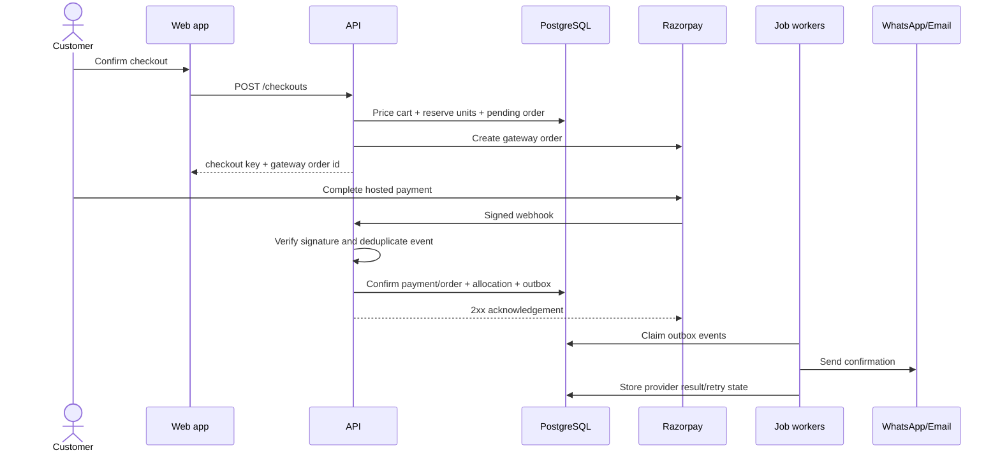
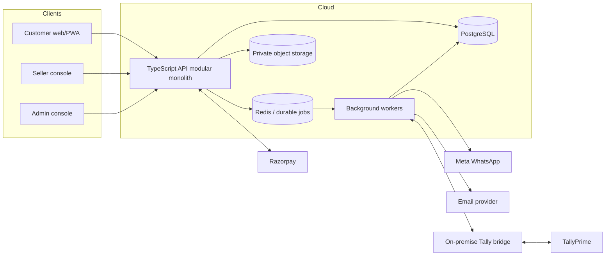

# Tiny Kars production requirements and architecture

Status: proposed baseline<br>
Prepared: 26 October 2026<br>
Scope: customer storefront, administration, seller billing, payments, inventory, fulfilment, loyalty, refunds, notifications, and TallyPrime integration

## 1. Executive decision

The existing React application is a strong sales prototype, but it is intentionally browser-only. Production should keep the current React/TypeScript frontend and add a TypeScript modular-monolith backend, PostgreSQL, object storage, a durable job queue, and a small on-premise Tally bridge.

This is the right first production architecture because checkout, stock, serial numbers, vouchers, credits, refunds, and invoices need database transactions and audit trails. Microservices would add deployment and consistency problems before the sales volume justifies them.

The initial production shape is:

- Responsive web/PWA for customers, sellers, and admins. A separate native mobile application is not required for the first release unless app-store distribution or device-only features become mandatory.
- One backend deployment, divided into strict modules: identity, catalogue, inventory, cart, checkout, payments, orders, fulfilment, promotions, loyalty, wallet, billing, notifications, imports, and accounting sync.
- PostgreSQL as the source of truth.
- Redis-backed jobs for notifications, imports, webhooks, and Tally sync.
- S3-compatible private object storage for product images and controlled uploads.
- Razorpay hosted checkout; the application never stores card, UPI, CVV, or banking credentials.
- Meta WhatsApp Business Platform and an email provider, called asynchronously through a transactional outbox.
- A Tally bridge installed on the billing computer/local network. It securely pulls cloud jobs and exchanges JSON/XML with TallyPrime.

## 2. Interpreted requirements

The raw notes have been normalised as follows.

| ID    | Requirement                  | Production acceptance criterion                                                                                                                                                                                                 |
| ----- | ---------------------------- | ------------------------------------------------------------------------------------------------------------------------------------------------------------------------------------------------------------------------------- |
| FR-01 | Public product visibility    | Guests can browse, search, filter, and open products without signing in. Sign-in is required only for account-specific actions and checkout confirmation.                                                                       |
| FR-02 | Sign-up and sign-in          | Customers can register, verify their phone/email, sign in, sign out, and reset a forgotten password through an expiring one-time token/OTP. Successful reset revokes old sessions.                                              |
| FR-03 | Shipping amount              | Checkout calculates shipping server-side from configurable rules. Admin can manage rules; authorised staff can override shipping with a required reason and audit entry.                                                        |
| FR-04 | Online payment               | Backend creates a Razorpay order. An order is confirmed only after a verified, idempotent server webhook/capture check. Client-side success alone is not trusted.                                                               |
| FR-05 | Confirmation messages        | A confirmed order queues WhatsApp and email confirmations exactly once. Failures are retried and visible to admin without rolling back a successful payment.                                                                    |
| FR-06 | Past orders                  | Customers see only their own order history, invoices, payment state, fulfilment timeline, tracking, refunds, and wallet credits.                                                                                                |
| FR-07 | Delivery confirmation        | Preferred: courier webhook/tracking integration. MVP fallback: authorised staff marks delivered with timestamp, actor, optional proof/reference, and audit log. Customer OTP can be added later.                                |
| FR-08 | Loyalty points               | Admin configures earn rate, redemption value, expiry, minimum order, cap, excluded products, and stacking rules. Points use an immutable ledger, not a mutable balance alone.                                                   |
| FR-09 | Bulk CSV                     | Admin uploads a CSV to a staging area, receives row-level validation, previews creates/updates, then explicitly commits an idempotent import job.                                                                               |
| FR-10 | Unique codes and labels      | Every product has a unique SKU. Each physical unit may also have a unique inventory serial/barcode. Labels can be selected and printed from admin. Random product names are never used as identifiers.                          |
| FR-11 | Five product views           | A product supports five ordered image slots: front, rear, left, right, and top/detail. Admin preview validates type, size, and required alt text.                                                                               |
| FR-12 | Product attributes           | Product name, brand, price, year of manufacture, series, scale, condition, description, MRP, stock policy, and status are separate fields. Final product data will be supplied by Gopal Sagar.                                  |
| FR-13 | Filters                      | Preserve all demo filters: brand, series, scale, price, condition, in-stock, rarity, offers, search, and sorting. Add year when data is available. Filter state remains URL-shareable.                                          |
| FR-14 | Vouchers                     | Admin creates fixed/percentage vouchers with validity, minimum spend, caps, scope, total redemption limit, and per-customer limit. A one-time code is atomically consumed at order confirmation and cannot be raced or reused.  |
| FR-15 | Refunds and store credits    | Admin may refund to the original payment method or issue store credit, subject to permissions. Wallet credits/debits use an immutable ledger. Gateway references and status are stored; payment credentials are not.            |
| FR-16 | Billing                      | Online and offline sales are separate channels but use one invoice service and one legal number sequence policy. Invoices are immutable after issue; corrections use credit notes.                                              |
| FR-17 | Invoice/serial mapping       | Online orders and manual bills contain invoice numbers and sold unit serials where serial tracking is enabled. Duplicate invoice and serial assignment is impossible at database level.                                         |
| FR-18 | TallyPrime                   | Confirmed sales, cancellations, refunds/credit notes, taxes, and stock changes are synced through durable, idempotent jobs with mapping, retry, reconciliation, and a dead-letter view.                                         |
| FR-19 | Admin login                  | Admin routes require server-enforced role and optional MFA. Sensitive changes are audited with actor, time, before/after values, IP, and correlation ID.                                                                        |
| FR-20 | Seller role                  | Seller has read-only access to catalogue, stock, customers required for billing, and past bills; may generate offline bills. Seller cannot edit products, stock, prices, vouchers, refunds, users, settings, or Tally mappings. |
| FR-21 | Payment confirmation in Meta | WhatsApp confirmation is a notification after payment confirmation, not a substitute for Razorpay verification. Approved utility templates are used outside the customer-service window.                                        |

## 3. Important domain distinctions

### Product, SKU, and unit serial are different

- Product: the catalogue model shown to a customer.
- SKU: the business identifier for that product/variant, for example `HW-FERRARI-F40-1990-164`.
- Inventory unit: one physical sellable piece.
- Unit serial/barcode: the unique code printed on a label, for example `TKU-01J...`.

A quantity of 20 for one SKU can therefore create 20 unit records when serial tracking is enabled. Code generation should use a database sequence or ULID/UUID-derived value plus a check digit. It must not depend on a random product name.

Use Code 128 for printable internal labels because it supports compact alphanumeric values and common scanners. Add QR only when a phone-friendly admin deep link is useful. Do not present internally generated codes as manufacturer barcodes.

### Store credit is not a payment credential

The system stores wallet ledger entries, Razorpay order/payment/refund IDs, amounts, status, and safe metadata. It must never store a customer's card number, CVV, UPI PIN, bank password, or gateway secret. Razorpay secrets live only in a secret manager/environment at runtime.

### Offline and online sales share inventory, not workflows

An online order originates at checkout and is confirmed by payment/COD policy. An offline sale originates at the billing desk. Both allocate physical units and create accounting events, but reporting must retain `sales_channel = online | offline`.

## 4. Users and permissions

| Capability                       |      Customer       |     Seller      |      Admin       | Delivery staff (optional) |
| -------------------------------- | :-----------------: | :-------------: | :--------------: | :-----------------------: |
| Browse products                  |         Yes         |      Read       |       Read       |            No             |
| Manage own account/orders        |         Yes         |       No        |   Support view   |            No             |
| Generate offline bill            |         No          |       Yes       |       Yes        |            No             |
| Read inventory                   | Public availability |       Yes       |       Yes        |            No             |
| Change inventory/products/prices |         No          |       No        |       Yes        |            No             |
| Manage shipping/vouchers/loyalty |         No          |       No        |       Yes        |            No             |
| Refund or issue credits          |         No          |       No        | Permission-gated |            No             |
| Mark fulfilment/delivery         |         No          | Read by default |       Yes        |   Assigned orders only    |
| Manage roles/integrations        |         No          |       No        | Super-admin only |            No             |

Permissions must be checked in backend use cases and database queries. Hiding a frontend button is not authorisation.

## 5. Core customer journeys

### 5.1 Browse to paid order

1. Guest browses and filters products.
2. Guest adds available items to cart.
3. At checkout, customer signs in/registers and supplies a delivery address.
4. Backend prices the cart from current product and promotion data; the client cannot submit authoritative totals.
5. Backend validates pincode/shipping rule, applies an eligible voucher/loyalty redemption, creates a short inventory reservation, and creates a pending order plus Razorpay order.
6. Customer completes hosted Razorpay Checkout.
7. Razorpay calls the backend webhook.
8. Backend verifies the signature, records the event idempotently, confirms/captures payment state, converts reservations to allocations, consumes voucher usage, and moves the order to `confirmed` in one transaction.
9. A transactional outbox queues invoice/accounting, email, and WhatsApp events.
10. Workers deliver messages and sync Tally independently with retry.
11. Unpaid reservations expire and release inventory.



### 5.2 Refund to original method

1. Admin opens an eligible paid order and enters amount/reason.
2. Backend checks permission, refundable balance, order state, and idempotency key.
3. Backend creates `refund_requested`; a worker calls Razorpay.
4. Gateway webhook/status updates it to `processing`, `succeeded`, or `failed`.
5. Only a successful refund posts the financial reversal and Tally credit-note event.
6. Restocking is a separate inspected-return decision; a refund must not silently increase sellable stock.

### 5.3 Refund as store credit

1. Admin selects store credit and enters amount/reason.
2. One database transaction creates the refund decision and a positive wallet ledger entry.
3. The customer's available wallet balance is the sum of posted, unexpired ledger entries minus debits.
4. Checkout redeems credit through a negative ledger entry linked to the order.
5. Reversal creates a compensating entry; ledger rows are never edited or deleted.

### 5.4 Offline seller billing

1. Seller signs in and selects catalogue items/serials or an approved custom line.
2. Backend validates availability and current authorised prices.
3. Seller records allowed payment method/reference and generates the invoice.
4. Transaction issues the next legal invoice number, assigns unit serials, records offline payment, decrements stock, and emits Tally jobs.
5. Invoice snapshot is immutable and printable. Any correction becomes a cancellation/credit note under admin permission.

## 6. Order and payment state machines

Keep payment state separate from fulfilment state.

```text
Payment
pending -> authorized -> captured
pending/authorized -> failed
captured -> partially_refunded -> refunded
captured/partially_refunded -> chargeback (future)

Fulfilment
pending_payment -> confirmed -> packed -> shipped -> out_for_delivery -> delivered
pending_payment -> expired
confirmed -> cancelled
delivered -> return_requested -> return_received -> closed
```

Rules:

- A browser callback cannot set `captured`.
- Status transitions use an allow-list and compare-and-set/version check.
- Every transition stores actor/source, timestamp, reason, and correlation ID.
- `delivered` requires courier evidence or an authorised staff action.
- A cancellation, refund, and restock are separate commands even when a UI groups them.

## 7. Logical architecture



### Recommended implementation stack

- Frontend: retain React, TypeScript, Vite; migrate browser service functions to typed API clients. Use React Query/TanStack Query for server state if desired.
- Backend: Node.js LTS + TypeScript with Fastify or NestJS. The key requirement is module boundaries, runtime validation, transactions, and generated OpenAPI—not a specific framework logo.
- Database: PostgreSQL with Prisma or Drizzle migrations. Money is stored as integer paise, never floating point.
- Authentication: secure HTTP-only same-site cookies with rotating sessions. Use Argon2id for passwords if passwords remain; rate-limit OTP and reset paths. Add MFA for admins.
- Jobs: Redis + BullMQ or a managed durable queue. Business correctness remains in PostgreSQL; jobs are retryable and idempotent.
- Files: S3-compatible storage, signed upload URLs, MIME/content inspection, size limits, image processing, and private-by-default return evidence.
- Observability: structured logs, error tracking, metrics, trace/correlation IDs, job dashboard, webhook and sync audit views.

## 8. Backend modules

| Module        | Owns                                                     | Key rules                                                                |
| ------------- | -------------------------------------------------------- | ------------------------------------------------------------------------ |
| Identity      | users, roles, sessions, verification/reset tokens        | Server RBAC, admin MFA, session revocation, rate limits                  |
| Catalogue     | products, brands, series, media, attributes, filters     | Published products only on public API; image slots ordered and validated |
| Inventory     | locations, stock units, serials, reservations, movements | No negative availability; serial unique; all movement reasons audited    |
| Pricing       | price lists, shipping rules, promotion evaluation        | Server calculates final price; rules versioned                           |
| Promotions    | vouchers, redemptions, usage limits                      | Redemption protected by unique constraints/row locks                     |
| Loyalty       | earn/redeem policy and ledger                            | Pending points mature after return window; compensating entries only     |
| Wallet        | store-credit ledger and expiry                           | Money in paise; posted entries immutable; no payment secrets             |
| Checkout      | cart snapshot, shipping quote, reservation orchestration | Idempotency key required; pending order expiration                       |
| Payments      | Razorpay order/payment/refund/webhook events             | Signature verification, event dedupe, server-to-server truth             |
| Orders        | order snapshot, status transitions, returns              | Customer ownership checks; immutable commercial snapshot                 |
| Fulfilment    | packing, shipment, tracking, delivery proof              | Courier webhook preferred; staff fallback audited                        |
| Billing       | invoice/credit-note sequences and PDFs                   | Immutable issued document; channel retained; legal fields snapshotted    |
| Notifications | templates, sends, preferences                            | Outbox, retry, provider IDs, exact-once business intent                  |
| Imports       | uploads, validation rows, commit jobs                    | Preview before commit; checksum/idempotency; error report                |
| Accounting    | Tally mappings, jobs, reconciliation                     | At-least-once delivery with idempotent external reference                |
| Audit         | sensitive action log                                     | Append-only and searchable by actor/entity/correlation ID                |

## 9. Data model

The following is the minimum production model. Timestamps and audit columns are omitted from the list but required.

| Entity                       | Essential fields/constraints                                                                                                   |
| ---------------------------- | ------------------------------------------------------------------------------------------------------------------------------ |
| `users`                      | id, name, phone unique, email unique nullable, password_hash nullable, status                                                  |
| `roles`, `user_roles`        | role enum/mapping; permissions resolved server-side                                                                            |
| `sessions`                   | hashed token, user_id, expires_at, revoked_at, device metadata                                                                 |
| `addresses`                  | user_id, contact fields, pincode, validation status                                                                            |
| `products`                   | id, sku unique, name, brand_id, series_id, manufacture_year, scale, condition, price_paise, mrp_paise, status, serial_tracking |
| `product_media`              | product_id, slot enum, object_key, alt_text, sort_order; unique(product_id, slot)                                              |
| `inventory_units`            | id, product_id, serial_code unique, barcode_value unique, location_id, state                                                   |
| `inventory_balances`         | product_id/location_id, on_hand, reserved; check nonnegative                                                                   |
| `inventory_movements`        | product/unit, quantity, from/to state/location, reason, reference type/id, actor                                               |
| `reservations`               | order_id, product/unit, quantity, expires_at, state                                                                            |
| `orders`                     | number unique, user_id, channel, price/shipping/tax/discount snapshots, payment_state, fulfilment_state, version               |
| `order_items`                | product snapshot, sku, unit price, quantity, tax, discount                                                                     |
| `order_unit_allocations`     | order_item_id, inventory_unit_id unique                                                                                        |
| `payments`                   | provider, provider_order_id unique, provider_payment_id unique nullable, amount, state, safe metadata                          |
| `payment_events`             | provider_event_id unique, signature_valid, payload reference/hash, processed_at                                                |
| `refunds`                    | order/payment, method enum, amount, reason, provider_refund_id unique nullable, state, idempotency_key unique                  |
| `shipping_rules`             | rule priority, pincode/zone/order-value predicates, amount, validity, enabled                                                  |
| `shipments`                  | order, courier, tracking unique nullable, state, proof reference                                                               |
| `vouchers`                   | code unique, type/value, validity, limits, scope, stacking, enabled                                                            |
| `voucher_redemptions`        | voucher_id, user_id, order_id unique, amount; unique constraints enforce policy                                                |
| `loyalty_ledger`             | user_id, points signed, state, expires_at, source/reference unique                                                             |
| `wallet_ledger`              | user_id, amount_paise signed, state, expires_at, source/reference unique                                                       |
| `invoices`                   | invoice_number unique, order_id nullable, channel, immutable JSON snapshot, issued_at                                          |
| `credit_notes`               | number unique, invoice_id, immutable snapshot                                                                                  |
| `notification_outbox`        | event key unique, channel, template, recipient, payload, state, attempts, next_attempt                                         |
| `import_jobs`, `import_rows` | checksum/idempotency, row input, action, validation errors, commit state                                                       |
| `accounting_jobs`            | event key unique, type, entity reference, payload, state, attempts, Tally response                                             |
| `tally_mappings`             | internal entity/key to Tally company/ledger/stock-item mapping                                                                 |
| `audit_logs`                 | actor, action, entity, before/after redacted JSON, IP, correlation ID; append-only                                             |

## 10. API surface

Representative endpoints; final naming is generated into OpenAPI.

```text
POST   /auth/register
POST   /auth/login
POST   /auth/verify
POST   /auth/forgot-password
POST   /auth/reset-password
POST   /auth/logout

GET    /products
GET    /products/:slug
POST   /media/uploads                 admin

POST   /shipping/quote
POST   /checkouts                     authenticated, idempotent
GET    /orders                        own orders unless privileged
GET    /orders/:number
POST   /orders/:number/cancel
POST   /orders/:number/returns

POST   /payments/razorpay/webhook     raw body, signature verified
POST   /admin/orders/:number/refunds  privileged, idempotent
POST   /admin/orders/:number/status   privileged transition

GET    /wallet
GET    /loyalty
POST   /admin/vouchers
POST   /admin/loyalty/policies

POST   /admin/imports/products
GET    /admin/imports/:id
POST   /admin/imports/:id/commit
GET    /admin/labels?unit_ids=...

POST   /seller/invoices               seller/admin
GET    /seller/invoices
GET    /admin/accounting/jobs
POST   /admin/accounting/jobs/:id/retry
```

All mutating financial endpoints accept an `Idempotency-Key`. List endpoints use cursor pagination. Admin exports are authorised, logged, and streamed.

## 11. CSV contract

Recommended product template:

```csv
external_id,sku,name,brand,series,manufacture_year,scale,condition,price_inr,mrp_inr,quantity,serial_tracking,front_image_url,rear_image_url,left_image_url,right_image_url,top_image_url,status
```

Rules:

- `external_id` or `sku` determines whether a row creates or updates; no fuzzy name matching.
- Blank SKU may be generated only when the admin explicitly selects “generate missing SKUs.” Generated values are previewed before commit.
- Decimal INR input is converted to paise using strict decimal parsing.
- Duplicate SKUs within the file or database are row errors.
- `quantity` is a stock movement, not a blind overwrite, unless an explicit stocktake import mode is selected.
- When serial tracking is true, committing quantity `N` generates `N` inventory units and label codes.
- Remote image URLs are optional; production should fetch, scan, transform, and store copies rather than hot-linking.
- The import keeps the source file hash, actor, preview result, commit result, and downloadable error CSV.

## 12. Images

- Five named slots: front, rear, left, right, top/detail.
- Accept JPEG, PNG, or WebP by verified content, not filename alone.
- Enforce maximum dimensions/file size, strip metadata, generate responsive WebP/AVIF derivatives, and preserve an archival original if required.
- Use signed direct uploads; the backend finalises media only after inspection.
- Product cannot publish until its minimum image rule is met. Decide whether all five are mandatory or whether front plus placeholders is acceptable.
- Alt text is required for accessibility. Reordering cannot change the semantic slot.

## 13. Shipping

Model shipping as prioritised, versioned rules:

- exact pincode allow/deny;
- pincode prefix/zone;
- order value threshold for free shipping;
- weight/quantity slab if product dimensions become available;
- default national rate;
- staff override with reason.

The quote response contains the rule version and expiration. Checkout recalculates before creating payment. A client-supplied shipping amount is never accepted as authoritative.

## 14. Vouchers, loyalty, and wallet stacking

These three benefits can easily produce loss-making orders, so the admin must explicitly configure stacking.

Recommended MVP policy:

- One voucher per order.
- Wallet credit may be combined with a voucher because it represents customer money/compensation.
- Loyalty redemption may not stack with a voucher initially.
- Points are earned on net merchandise value after voucher and wallet allocation, excluding shipping and tax.
- Earned points remain pending until the return window closes.
- Refunds reverse earned points proportionally; the refund value accounts for any redeemed points.

All calculations happen on the backend and are saved as per-line allocation snapshots for correct partial refunds.

## 15. Notifications

Events such as `order.confirmed`, `order.shipped`, `order.delivered`, `refund.succeeded`, and `wallet.credited` create outbox records within the same transaction as the business change.

Each channel worker:

- uses an approved, versioned template;
- sends no payment secret or excessive personal data;
- stores provider message ID and delivery status;
- retries transient errors with exponential backoff/jitter;
- dead-letters permanent failures for admin action;
- deduplicates on `event + channel + recipient + template version`.

WhatsApp and email confirmation should never execute inside the payment webhook request. The webhook should commit quickly and return 2xx.

## 16. TallyPrime integration

Do not expose TallyPrime's local HTTP port to the public internet. Install a signed bridge on the machine/network where TallyPrime runs:

1. Bridge authenticates outbound to the cloud with rotating credentials/mTLS.
2. Bridge claims pending accounting jobs.
3. Bridge converts canonical business events to the configured TallyPrime JSON/XML representation.
4. Bridge posts to the local Tally endpoint or writes an approved offline import file.
5. Bridge reports the Tally response and external reference.
6. Cloud marks success or schedules retry. Admin can reconcile and replay failed jobs.

The accounting mapping must be approved before launch: company, sales ledgers, customer ledger strategy, GST/tax ledgers, shipping ledger, discount ledger, wallet/store-credit liability ledger, Razorpay clearing ledger, refund/credit-note mapping, stock items, godowns, and voucher types.

Tally sync is at-least-once. Therefore every export needs a stable external reference and duplicate detection. Tally failure never changes a successfully paid customer order; it creates an operational exception.

## 17. Security and compliance baseline

- TLS everywhere; HSTS and secure headers.
- Secure, HTTP-only, same-site session cookies; CSRF protection for cookie-authenticated mutations.
- Password hashes use Argon2id with current parameters. OTP/reset values are hashed, single-use, short-lived, and rate-limited.
- MFA required for admin/super-admin; re-authentication for refunds, role changes, and secret rotation.
- Backend RBAC plus ownership checks on every query.
- Razorpay webhook signature verified over the raw request body; events stored and deduplicated.
- Secrets in a managed secret store; never in Git, CSV, browser bundle, logs, or Tally job payloads.
- Personally identifiable data encrypted at rest where appropriate and redacted in logs.
- File uploads are scanned/decoded, limited, and served from a separate asset domain.
- Backups, point-in-time recovery, restoration drills, retention/deletion policy, and incident runbook.
- Audit logs for authentication, imports, price/stock changes, voucher policy, wallet entries, refunds, invoices, delivery confirmation, role changes, and Tally replay.
- Razorpay-hosted UI limits payment-data exposure, but the business still needs legal/privacy, tax, refund, and data-retention review before launch.

## 18. Reliability rules

- Use database transactions for reservation/allocation, voucher consumption, wallet postings, loyalty postings, invoice sequence issuance, and inventory movement.
- Use unique constraints as the final concurrency defence, not only application checks.
- Require idempotency on checkout, invoice, refund, webhook, import commit, and Tally event creation.
- Use an outbox table written in the same transaction as business data.
- Use optimistic locking/version columns for order and inventory workflows.
- Never retry a non-idempotent external call without a stable provider/idempotency reference.
- Reconcile captured payments with confirmed orders and Tally jobs daily.

## 19. Current prototype gap analysis

| Area           | Current prototype                        | Required for production                                                   |
| -------------- | ---------------------------------------- | ------------------------------------------------------------------------- |
| Persistence    | localStorage with last-write-wins        | PostgreSQL, transactions, migrations, backup/PITR                         |
| Authentication | public demo user switching and fixed OTP | verified identity, secure sessions, reset, rate limit, admin MFA          |
| Roles          | simulated customer/admin                 | backend customer/seller/admin permissions and audit                       |
| Checkout       | local order plus WhatsApp deep link      | server pricing, reservation, Razorpay, verified webhooks                  |
| Notifications  | user manually sends WhatsApp message     | approved templates, email, outbox/retry/status                            |
| Inventory      | quantity on product                      | locations, reservations, movements, optional serialised units             |
| Images         | repeated local illustration crops        | five semantic uploads and production object storage                       |
| CSV            | immediate browser import requiring SKU   | staged import, preview, generated codes, idempotency, error report        |
| Vouchers       | reusable percentage codes                | one-time/per-user limits, atomic redemption, scope and audit              |
| Loyalty/wallet | absent                                   | immutable ledgers, policy, expiry, refund allocation                      |
| Refund         | local status and stock restoration       | provider refund/store credit, separate inspection/restock, credit note    |
| Billing        | browser-saved bill/PDF print             | durable invoice sequence, immutable snapshots, channel, serial allocation |
| Delivery       | admin status advance                     | courier event or audited staff confirmation/proof                         |
| Tally          | simulated queue/failures                 | on-prem bridge, approved mappings, durable idempotent sync/reconciliation |

The current prototype should remain a reference UI while production services are introduced route by route. Do not mistake a clickable feature for a completed backend capability.

## 20. Delivery plan and gates

### Phase 0 — decisions and production foundation

- Confirm business rules and tax/accounting ownership.
- Provision environments, CI/CD, secrets, database, object storage, queue, monitoring, migrations, and backup.
- Implement identity, sessions, RBAC, audit, and admin MFA.

Exit gate: threat model reviewed; admin cannot be reached without server authorisation; restore test passes.

### Phase 1 — catalogue and inventory

- Production product model and five-view media.
- Filters, admin CRUD, locations, movements, serial/unit labels.
- Staged CSV import and printable labels.

Exit gate: concurrent stock tests pass; duplicate SKU/serial impossible; import rollback and error export verified.

### Phase 2 — commerce

- Cart pricing, shipping rules, addresses, reservations, orders, one-time vouchers.
- Razorpay test-mode checkout and webhook processing.
- Customer history and invoice snapshot.

Exit gate: webhook replay cannot duplicate an order/payment/voucher use; overselling load test passes.

### Phase 3 — operations

- Fulfilment, delivery confirmation, returns, original-method refund, store-credit wallet.
- WhatsApp/email outbox, templates, retries, delivery status.
- Seller billing and offline sales.

Exit gate: refund reconciliation and permission matrix pass; seller cannot mutate protected data.

### Phase 4 — loyalty and Tally

- Configurable loyalty ledger.
- Tally bridge, mapping, sync, retries, reconciliation, credit notes.
- Operational dashboards and alerts.

Exit gate: accountant signs off representative sale/refund/tax/discount/shipping scenarios in a Tally test company.

### Phase 5 — launch

- Security testing, accessibility, performance/load, observability, support and incident drills.
- Razorpay live activation, WhatsApp templates, email domain authentication, privacy/refund terms.
- Controlled data import and soft launch.

## 21. Test strategy

- Unit/property tests for money, promotions, loyalty, wallet, shipping, and state transitions.
- Integration tests with real PostgreSQL/Redis and provider sandboxes or signed fixtures.
- Concurrency tests for last item, one-time voucher, invoice number, serial allocation, and repeated refund clicks.
- Contract tests for Razorpay webhook events, notification templates, and Tally bridge payloads.
- End-to-end tests for guest browse, registration/reset, successful/failed payment, order history, seller bill, delivery, refund, wallet redemption, CSV import, and role denial.
- Security tests for IDOR, CSRF, injection, upload abuse, brute force, session revocation, privilege escalation, webhook forgery, and secret leakage.
- Reconciliation tests: payment captured without confirmed order, order without invoice, inventory imbalance, and failed/dead-letter Tally job.

## 22. Business decisions still required

These answers change implementation or accounting and must be signed off before their module is built:

1. Is customer authentication phone OTP only, email/password, or both?
2. Is checkout available only after login, and is guest checkout intentionally excluded?
3. Which shipping model applies: flat rate, pincode zones, weight, order value, or courier live rates? Who may override it?
4. Are all products individually serialised, or only selected high-value/rare stock?
5. Are five images mandatory before publication? What are the exact five semantic views?
6. Does seller billing decrement the same live inventory? Can sellers add custom lines or change price/discount?
7. What is the legal invoice prefix, financial-year reset rule, GSTIN, place-of-supply logic, HSN, and tax-inclusive/exclusive policy? A CA/accountant must approve this.
8. For refunds, when is store credit allowed, can it expire, and can customers choose original method versus credit?
9. Loyalty earn/redemption/expiry/stacking rules and launch liability cap.
10. Coupon scope and definition of “one time”: once globally, once per customer, or a unique generated code per recipient?
11. Courier/tracking provider, or acceptance of staff delivery confirmation for MVP.
12. Exact WhatsApp templates, opt-in evidence, sender number, and email provider/domain.
13. TallyPrime version, deployment machine/network, company, ledgers, voucher types, stock items, godowns, and whether stock authority is website or Tally.
14. Expected catalogue size, monthly orders, billing counters, admin/seller count, and peak traffic.
15. Is “mobile app” satisfied by an installable responsive PWA, or is a separately distributed Android/iOS app contractual?

## 23. Commercial boundary

Development cost, cloud running cost, and vendor transaction/message charges must be quoted separately.

- Razorpay: public pricing is pay-as-you-go and can vary by payment method, promotion, volume, and contract. Confirm the merchant's live dashboard/contract immediately before quoting.
- Meta WhatsApp: messaging is usage-based by category/country and can also include a business solution provider fee. Templates, verification, and opt-in work are implementation scope; message spend is pass-through.
- Email/SMS, cloud hosting/storage, domains, monitoring, Tally licensing/customisation, courier APIs, and app-store accounts are pass-through unless explicitly included.
- Refund/chargeback and instant-settlement charges must be checked against the merchant agreement.

The WhatsApp note mentioning `₹85k + ₹25k = ₹110k` and the separate `₹40k–₹60k backend` discussion are commercial inputs, not a safe estimate for this full production scope. The full scope includes identity, payment correctness, serialised inventory, permissions, billing, wallet/loyalty ledgers, notifications, and an on-premise accounting bridge. Quote only after the decisions above are resolved and each phase has deliverables, exclusions, acceptance tests, support period, and change-control terms.

## 24. Definition of done

A feature is complete only when it has:

- implemented UI and backend behaviour;
- database migration and rollback plan;
- server-side authorisation and validation;
- audit/observability appropriate to its risk;
- unit/integration/end-to-end tests;
- idempotency and concurrency handling where relevant;
- provider sandbox verification for integrations;
- admin operational path for failures;
- documentation and acceptance evidence;
- no fake production success states or secrets in code.

## 25. External references

- [Razorpay payment gateway pricing](https://razorpay.com/pricing/) — confirm the merchant-specific live rate and optional-service charges before quoting.
- [Meta WhatsApp Business Platform pricing](https://developers.facebook.com/docs/whatsapp/pricing) — rates and charging rules change by market, category, and effective date.
- [TallyPrime integration documentation](https://help.tallysolutions.com/integrate-with-tallyprime/) — official overview of JSON, XML, HTTP, ODBC, and e-commerce/accounting integration patterns.
- [TallyPrime JSON integration](https://help.tallysolutions.com/tally-prime-integration-using-json-1/) — relevant to TallyPrime releases supporting native JSON/JSONEx; verify the client's installed version before selecting the bridge format.
